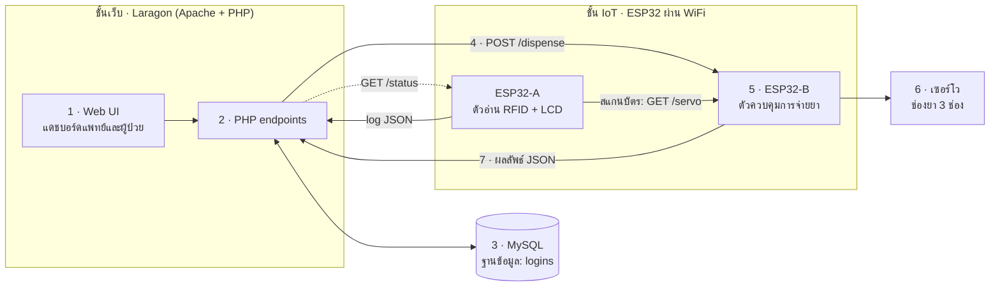
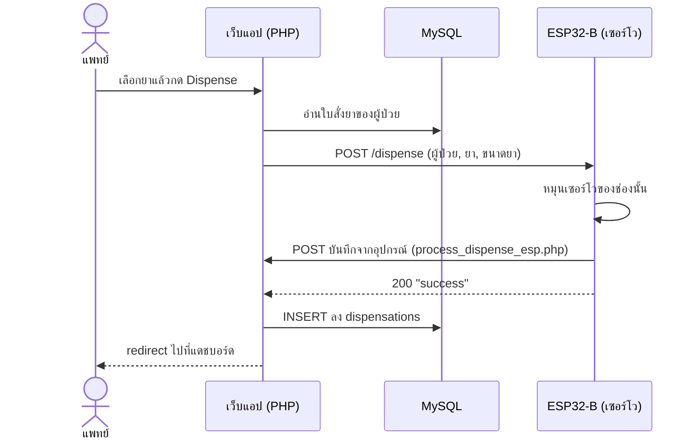
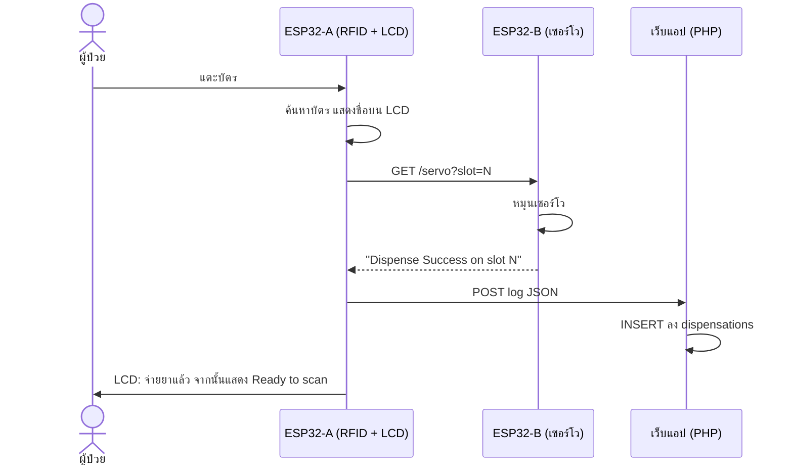
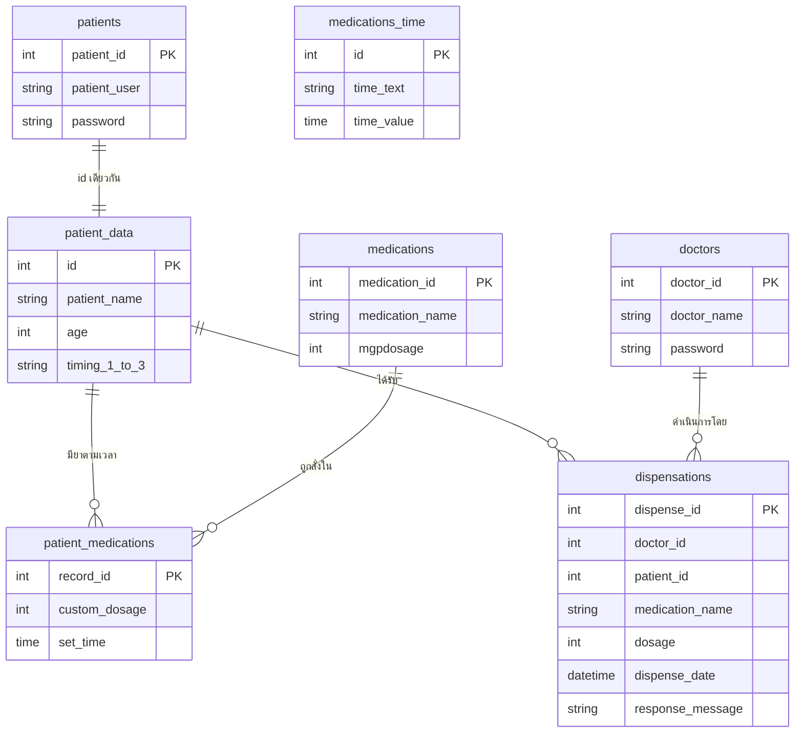

# MEDI-SERVE

[English](README.md) | **ไทย**

**Medical Service Extension** — เครื่องจ่ายยาที่เชื่อมต่อกับเว็บ สร้างจากไมโครคอนโทรลเลอร์ ESP32, เว็บแอปพลิเคชัน PHP + MySQL และฮาร์ดแวร์ที่ขับเคลื่อนด้วยเซอร์โวมอเตอร์

MEDI-SERVE รวมสามส่วนเข้าไว้ในระบบเดียวที่ทำงานได้จริง ได้แก่ **การเขียนโปรแกรม** (เว็บแอปและเฟิร์มแวร์), **ฐานข้อมูล** (ใบสั่งยา ตารางเวลา และบันทึกการจ่ายยา) และ **IoT** (บอร์ด ESP32 สองตัวสื่อสารกับเว็บเซิร์ฟเวอร์ผ่าน WiFi) แพทย์สามารถสั่งยาและสั่งจ่ายยาผ่านเบราว์เซอร์ได้ และผู้ป่วยสามารถรับยาได้โดยแตะบัตร RFID ที่เครื่อง

<!-- TODO: ใส่รูปหรือ GIF ของเครื่องตรงนี้ เช่น docs/images/machine.jpg -->

| | |
|---|---|
| **ผู้จัดทำ** | นายรัญชน์ ราชแพทยาคม |
| **โรงเรียน** | โยธินบูรณะ |

---

## หลักการทำงาน

ระบบทำงานเป็นสายการประมวลผล (pipeline) คำขอเริ่มต้นที่เบราว์เซอร์ ถูกตรวจสอบและบันทึกโดยเซิร์ฟเวอร์ แล้วจบลงที่การหมุนเซอร์โว จากนั้นผลลัพธ์จะไหลกลับเข้าฐานข้อมูล



| ขั้นตอน | สิ่งที่เกิดขึ้น | ตำแหน่งในโค้ด |
|---|---|---|
| 1. Auth | แพทย์และผู้ป่วยเข้าสู่ระบบด้วยบัญชีแยกกัน | `web/1_auth/` |
| 2. สั่งยา | แพทย์จัดการข้อมูลผู้ป่วย ยา และตารางเวลาการจ่ายยา | `web/2_prescribe/` |
| 3. คำขอจ่ายยา | แพทย์สั่งจ่ายยา หรือผู้ป่วยสแกนบัตร RFID | `web/3_dispense/`, `firmware/esp32_reader/` |
| 4. ส่งคำสั่งไปยังอุปกรณ์ | เซิร์ฟเวอร์ตรวจสอบว่าเครื่องออนไลน์ แล้วส่งคำสั่ง | `web/4_device/` |
| 5. การทำงานของอุปกรณ์ | ESP32-B หมุนเซอร์โวของช่องยาที่ร้องขอ | `firmware/esp32_dispenser/` |
| 6. บันทึกผล | บันทึกผลพร้อมผู้ป่วย ยา ขนาดยา และเวลา | `web/5_logging/` |
| 7. ตรวจสอบย้อนหลัง | แพทย์ดูบันทึกทั้งหมด ผู้ป่วยดูยาของวันนี้ว่า "รับแล้ว" หรือ "รอรับ" | `web/6_dashboards/` |

### การจ่ายยาสองทาง

**ผ่านเว็บ (แพทย์)**



**ผ่านบัตร RFID (ผู้ป่วย)**



หากแตะบัตรที่ไม่รู้จัก จอจะแสดง `Unknown Card / Access Denied` และจะไม่มีการจ่ายยา

---

## ฟีเจอร์

- **สองบทบาท** แพทย์จัดการได้ทุกอย่าง ส่วนผู้ป่วยดูตารางของตนเองได้อย่างเดียว
- **จัดการผู้ป่วยและใบสั่งยา** เพิ่ม แก้ไข และค้นหาผู้ป่วย ผู้ป่วยแต่ละคนมีช่องสั่งยาได้สูงสุดสามช่อง พร้อมขนาดยาและช่วงเวลา (ก่อน/หลังอาหาร และเช้า/กลางวัน/เย็น/ก่อนนอน)
- **ยาตามเวลา** เพิ่มมื้อยาพิเศษพร้อมตัวคูณขนาดยาและเวลาที่กำหนดเอง
- **รายการยา** พร้อมขนาดมิลลิกรัมต่อแคปซูล แก้ไขได้จากแดชบอร์ด
- **สถานะเครื่องแบบสด** แดชบอร์ดตรวจสอบบอร์ดตัวอ่านเป็นระยะ และปิดปุ่มจ่ายยาเมื่อเครื่องออฟไลน์
- **จ่ายยาด้วย RFID** พร้อมการแสดงผลบน LCD และปฏิเสธบัตรที่ไม่รู้จัก
- **บันทึกการจ่ายยาครบถ้วน** ทุกครั้งที่จ่ายยาจะบันทึกว่าใคร จ่ายอะไร เท่าไร เมื่อไร และฮาร์ดแวร์ตอบกลับอย่างไร
- **มุมมองการกินยารายวัน** ผู้ป่วยเห็นยาแต่ละมื้อของวันนี้เป็น *รับแล้ว* หรือ *รอรับ*
- **ขีดจำกัดความปลอดภัยในฐานข้อมูล** trigger จะไม่ยอมให้เพิ่มยาเกิน 8 ชนิด ซึ่งตรงกับจำนวนที่เครื่องบรรจุได้จริง

---

## เทคโนโลยีที่ใช้

| ชั้น | เทคโนโลยี |
|---|---|
| เว็บเซิร์ฟเวอร์ | Laragon (Apache + PHP 8, MySQL) |
| Backend | PHP พร้อม `mysqli` และ prepared statements |
| Frontend | HTML, CSS, JavaScript ล้วน (`fetch` / `XMLHttpRequest`) |
| ฐานข้อมูล | MySQL 8 / MariaDB (InnoDB, foreign keys, trigger) |
| เฟิร์มแวร์ | Arduino C++ บน ESP32 |
| ไลบรารีเฟิร์มแวร์ | `MFRC522`, `LiquidCrystal_I2C`, `ArduinoJson`, `ESP32Servo`, `ESPAsyncWebServer` (พร้อม `AsyncTCP`), `WebServer`, `HTTPClient` |
| โปรโตคอล | HTTP ผ่านเครือข่าย WiFi ภายใน, ข้อมูลแบบ JSON |

---

## จุดเด่นด้านวิศวกรรม

| โจทย์ | สิ่งที่สร้าง | เหตุผลที่สำคัญ |
|---|---|---|
| **สองทริกเกอร์ ใช้ตัวขับเคลื่อนตัวเดียว** | การกดปุ่มของแพทย์บนแดชบอร์ดและการแตะ RFID ของผู้ป่วยจบลงที่รูทีนเซอร์โวเดียวกันบน ESP32-B ผ่าน HTTP ธรรมดา (`POST /dispense` และ `GET /servo`) | ฮาร์ดแวร์มีเส้นทางโค้ดเดียวให้ทดสอบ และสเก็ตช์ของแต่ละบอร์ดเล็กลง HTTP ดีบักง่ายด้วยเบราว์เซอร์หรือ `curl` และไม่ต้องใช้ broker |
| **ความจุเกินกำหนดไม่ได้** | ขีดจำกัดยา 8 ชนิดเป็น trigger ในฐานข้อมูล (`limit_entries`) ไม่ใช่การตรวจในหน้า PHP | ใช้ได้เสมอไม่ว่าหน้าเว็บ สคริปต์ หรือคำสั่ง SQL ที่พิมพ์เองจะเพิ่มแถวเข้ามา |
| **ไม่ส่งคำสั่งไปยังเครื่องที่ออฟไลน์** | แดชบอร์ดตรวจสอบบอร์ดตัวอ่านผ่าน `check_status.php` และปิดปุ่มจ่ายยาเมื่อติดต่อเครื่องไม่ได้ | แพทย์ไม่สามารถสั่งจ่ายยาที่จะล้มเหลวโดยไม่มีการแจ้งเตือน |
| **ข้อมูลที่เชื่อมกันไม่คลาดเคลื่อน** | การสร้างผู้ป่วยจะเพิ่มข้อมูลผู้ป่วยและบัญชีล็อกอินใน transaction เดียว โดยใช้ id ร่วมกัน และปฏิเสธชื่อผู้ใช้ซ้ำ | ทดสอบโดยตั้งใจทำให้ตัวนับ auto-increment ของสองตารางไม่ตรงกัน ผลคือ id ยังตรงกัน |
| **รหัสผ่านปลอดภัยขึ้นโดยไม่ล็อกใครออก** | ใช้ `password_hash()` รหัสผ่านแพทย์แบบ plaintext เดิมจะถูกยอมรับหนึ่งครั้งแล้วแทนที่ด้วยค่าแฮชเมื่อแพทย์คนนั้นเข้าสู่ระบบครั้งถัดไป บัญชีบริการของ ESP32 (id 99) ไม่สามารถล็อกอินได้เลย | บัญชีเดิมยังใช้งานได้ ขณะที่ข้อมูลที่เก็บปลอดภัยขึ้น |
| **บันทึกเก็บประวัติไว้ครบ** | ตาราง `dispensations` ไม่มี foreign key โดยตั้งใจ | การลบผู้ป่วยหรือแพทย์จะไม่ลบประวัติการจ่ายยา |
| **บันทึกสามยุค แดชบอร์ดเดียว** | บันทึกช่วงพัฒนามีข้อความ "สำเร็จ" สามแบบที่เขียนโดยแอปและเฟิร์มแวร์คนละเวอร์ชัน หน้าผู้ป่วยรู้จักทุกแบบ | รายการเก่ายังแสดงเป็น *รับแล้ว* ได้ถูกต้อง |
| **ฐานข้อมูลที่สร้างซ้ำได้** | `database/schema.sql` สร้างขึ้นใหม่จากไฟล์สำรองฐานข้อมูลต้นฉบับ และเทียบทีละคอลัมน์ โดยมีส่วนที่เพิ่มโดยตั้งใจสี่อย่าง (`UNIQUE` สามตัวและ index หนึ่งตัว) | ใครก็สร้างฐานข้อมูลขึ้นใหม่ตั้งแต่ต้นแล้วได้โครงสร้างเดียวกัน |

## โครงสร้างโปรเจกต์

```
med-dispensing/
├── database/
│   ├── schema.sql              # ตาราง คีย์ และ trigger จำกัดยา 8 ชนิด
│   └── seed.sql                # แพทย์ ผู้ป่วย ยา และป้ายเวลาตัวอย่าง
├── web/                        # ให้ Laragon เปิดที่ /logins/
│   ├── index.php               # หน้าล็อกอิน
│   ├── config/                 # db_connect.php, config.example.php
│   ├── 1_auth/                 # ล็อกอิน ล็อกเอาต์ เปลี่ยนรหัสผ่าน
│   ├── 2_prescribe/            # ผู้ป่วย ยา ตารางเวลา
│   ├── 3_dispense/             # ฟอร์มและการจัดการคำขอจ่ายยา
│   ├── 4_device/               # ตรวจสถานะเครื่อง
│   ├── 5_logging/              # endpoint รับ callback จาก ESP32 และ logs/
│   ├── 6_dashboards/           # แดชบอร์ดแพทย์และผู้ป่วย
│   └── assets/                 # css, js
├── firmware/
│   ├── esp32_reader/           # บอร์ด RFID + LCD (ESP32-A)
│   └── esp32_dispenser/        # บอร์ดเซอร์โว (ESP32-B)
└── tests/                      # สคริปต์ทดสอบด้วยมือ
```

---

## เริ่มต้นใช้งาน

### 1. สิ่งที่ต้องมี

- [Laragon](https://laragon.org/) (Apache, PHP 8+, MySQL)
- Arduino IDE พร้อมบอร์ดแพ็กเกจ ESP32 และไลบรารีที่ระบุไว้ข้างต้น
- คอมพิวเตอร์และบอร์ด ESP32 ทั้งสองตัวอยู่ใน **เครือข่าย WiFi เดียวกัน**

### 2. เปิดเว็บแอป

โคลนโปรเจกต์ไปไว้ที่ `C:\laragon\www\` จากนั้นทำให้โฟลเดอร์ `web/` เข้าถึงได้ที่ `/logins/` (เฟิร์มแวร์ส่งข้อมูลมาที่พาธนี้) เปิด Command Prompt แบบผู้ดูแลระบบแล้วรัน:

```bat
mklink /D C:\laragon\www\logins C:\laragon\www\med-dispensing\web
```

### 3. สร้างฐานข้อมูล

ใน Laragon เปิด **Database** (HeidiSQL) แล้วเลือก **File → Run SQL file** และรันตามลำดับ:

1. `database/schema.sql`
2. `database/seed.sql`

หรือใช้เทอร์มินัลของ Laragon: `mysql -u root < database/schema.sql` แล้วตามด้วย `seed.sql`

โดยค่าเริ่มต้นแอปเชื่อมต่อด้วยผู้ใช้ `root` และไม่มีรหัสผ่าน หากต้องการเปลี่ยน ให้คัดลอก `web/config/config.example.php` เป็น `web/config/config.local.php` แล้วแก้ไข ไฟล์ local นี้ถูก git ละเว้นไว้

### 4. อัปโหลดเฟิร์มแวร์

เปิดแต่ละสเก็ตช์ แล้วตั้งชื่อและรหัสผ่าน WiFi รวมถึง IP สามค่าที่ส่วนต้นของไฟล์:

| IP | คืออะไร | ใช้ที่ไหน |
|---|---|---|
| `192.168.4.167` | คอมพิวเตอร์ที่รัน Laragon | สเก็ตช์ทั้งสอง (`logUrl` / `serverUrl`) |
| `192.168.4.186` | ESP32-B (ตัวจ่ายยา) | `esp32_reader.ino`, `web/3_dispense/process_dispense.php` |
| `192.168.4.180` | ESP32-A (ตัวอ่านบัตร) | `web/4_device/check_status.php` |

บอร์ดแต่ละตัวจะพิมพ์ IP ของตนที่ Serial Monitor (115200 baud) เมื่อเชื่อมต่อ ส่วน IP ของคอมพิวเตอร์ดูได้ด้วย `ipconfig` ให้แทนที่ IP ตัวอย่างทุกจุดที่ปรากฏให้ตรงกับเครือข่ายของคุณ

### 5. ลองใช้งาน

เปิด `http://localhost/logins/` แล้วล็อกอินด้วยบัญชีตัวอย่างจาก `seed.sql`:

| บทบาท | ชื่อผู้ใช้ | รหัสผ่าน |
|---|---|---|
| แพทย์ | `demo_doctor` | `demo123` |
| ผู้ป่วย | `demo_patient` | `demo123` |

บัญชีเหล่านี้มีไว้สำหรับสาธิตในเครื่องเท่านั้น ควรเปลี่ยนก่อนนำระบบไปใช้งานจริง

---

## HTTP interfaces

| อุปกรณ์ | คำขอ | หน้าที่ |
|---|---|---|
| ESP32-A | `GET /status` | ตอบ `enabled` เมื่อเครื่องออนไลน์ |
| ESP32-B | `GET /servo?slot=1..3` | หมุนเซอร์โวหนึ่งตัว และตอบ `Dispense Success on slot N` |
| ESP32-B | `POST /dispense` (`patient_id`, `medication_id`, `dosage`) | หมุนเซอร์โว ส่งบันทึกจากอุปกรณ์ แล้วตอบ `success` |
| เซิร์ฟเวอร์ | `GET /logins/4_device/check_status.php` | ตอบ `{"status": "enabled" \| "disabled"}` ให้แดชบอร์ด |
| เซิร์ฟเวอร์ | `POST /logins/3_dispense/process_dispense.php` | จัดการฟอร์มสั่งจ่ายยาของแพทย์ |
| เซิร์ฟเวอร์ | `POST /logins/5_logging/process_dispense_esp.php` | รับ JSON log จาก ESP32: `{"patient_id": 1, "medications": [{"medication_id": 1, "dosage": 500}]}` |

---

## ฐานข้อมูล



แพทย์ `99` เป็นบัญชีบริการที่สงวนไว้ บอร์ด ESP32 บันทึกการจ่ายยาภายใต้ id นี้ และบัญชีนี้ไม่สามารถใช้ล็อกอินได้

---

## ข้อจำกัดและแผนพัฒนา
 
- การสื่อสารระหว่างเบราว์เซอร์ เซิร์ฟเวอร์ และบอร์ด ESP32 เป็น HTTP แบบไม่เข้ารหัสและไม่มีการยืนยันตัวตนของอุปกรณ์ ออกแบบมาสำหรับเครือข่ายภายในที่ปิดเท่านั้น
- ชื่อและรหัสผ่าน WiFi รวมถึง IP ถูกเขียนตายตัวในสเก็ตช์และไฟล์ PHP สองไฟล์ ขั้นต่อไป: ย้ายไปไว้ในไฟล์ config เดียวของแต่ละฝั่ง
- การจับคู่บัตร RFID กับผู้ป่วยและช่องยาอยู่ในเฟิร์มแวร์ ขั้นต่อไป: เก็บการจับคู่ไว้ในฐานข้อมูล
- เครื่องมีช่องยาคงที่สามช่อง ช่องละหนึ่งเซอร์โว
- ยังไม่มีหน้าจอสร้างบัญชีแพทย์ ต้องเพิ่มลงฐานข้อมูลโดยตรง
- การจ่ายยาผ่านเว็บในปัจจุบันบันทึกสองแถว: หนึ่งจากเว็บแอป และหนึ่งจาก callback ของ ESP32
- แพทย์ลบแต่ละแถวจากแท็บบันทึกการจ่ายยาได้ และยังไม่มีบันทึกตรวจสอบ (audit trail) แยกต่างหาก

---

## สัญญาอนุญาต (License)

MIT License Copyright (c) 2026 Runch Rachapattayakhom