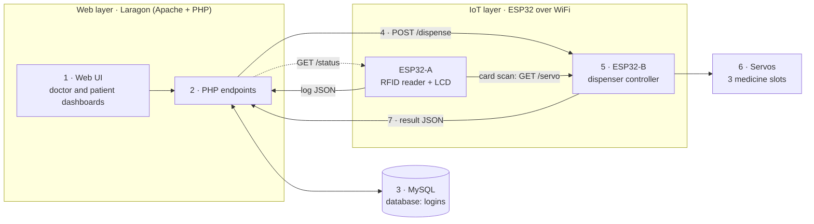
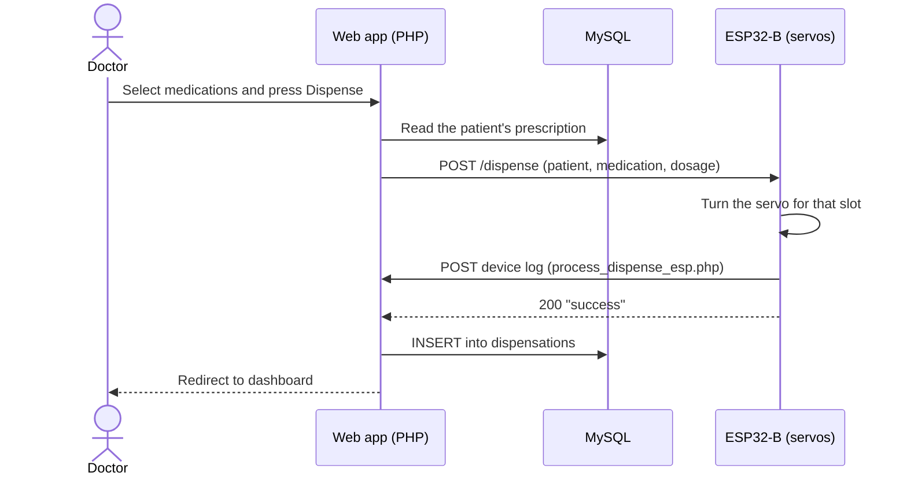
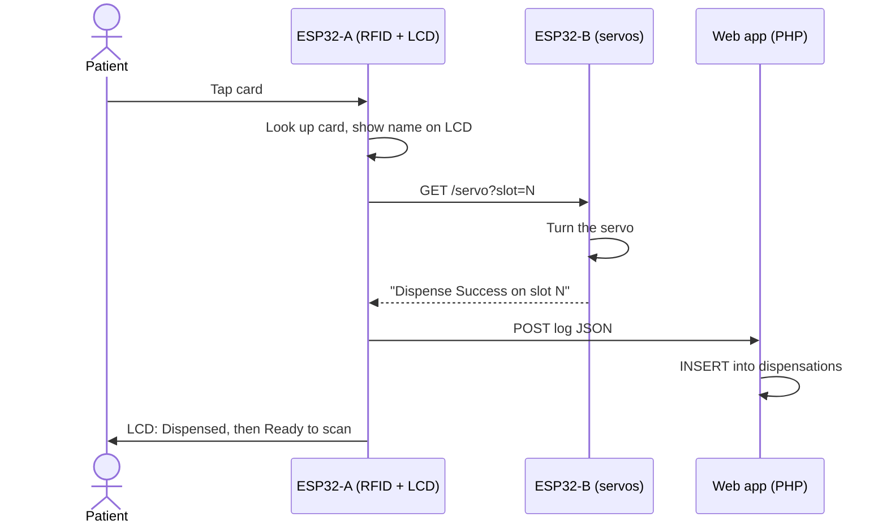
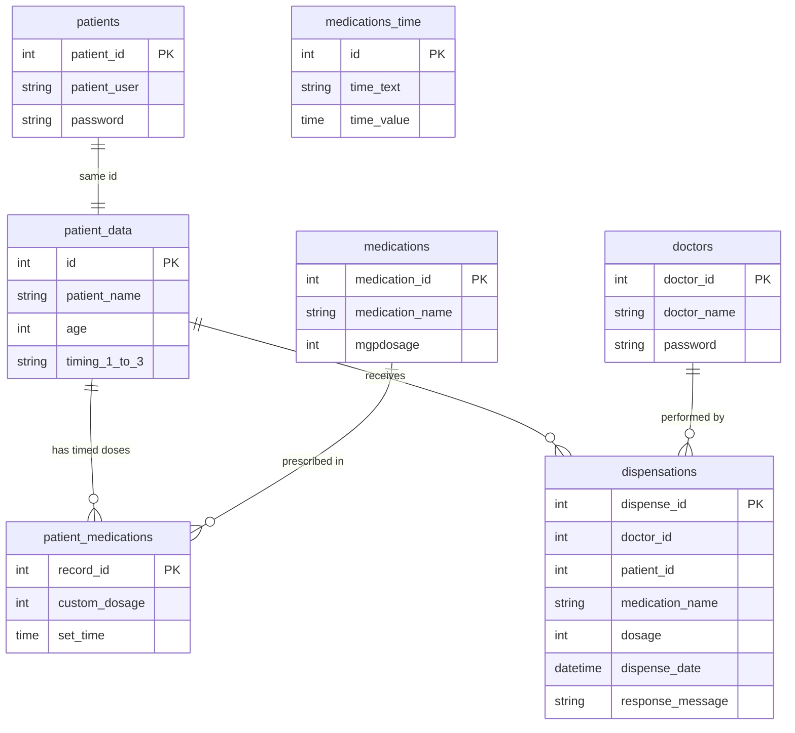

# MEDI-SERVE

**English** | [ไทย](README.TH.md)

**Medical Service Extension** — a web-connected medicine dispensing machine built with ESP32 microcontrollers, a PHP + MySQL web application, and servo-driven hardware.

MEDI-SERVE joins three worlds into one working system: **programming** (a web app and embedded firmware), **databases** (prescriptions, schedules and an audit log), and **IoT** (two ESP32 boards talking to the web server over WiFi). A doctor can prescribe and dispense from a browser, and a patient can collect their medicine by tapping an RFID card on the machine.

<!-- TODO: add a photo or GIF of the machine here, e.g. docs/images/machine.jpg -->

| | |
|---|---|
| **Author** | Runch Rachapattayakhom |
| **Institution** | Yothinburana |

---

## How it works

The system is a pipeline. A request starts in the browser, is validated and stored by the server, and ends as a servo movement; the result then flows back into the database.



| Stage | What happens | Where |
|---|---|---|
| 1. Auth | Doctors and patients log in with separate accounts | `web/1_auth/` |
| 2. Prescribe | Doctors manage patients, medications and timed schedules | `web/2_prescribe/` |
| 3. Dispense request | A doctor triggers a dispense, or a patient scans an RFID card | `web/3_dispense/`, `firmware/esp32_reader/` |
| 4. Device dispatch | The server checks the machine is online and sends the command | `web/4_device/` |
| 5. Actuation | ESP32-B turns the correct servo for the requested slot | `firmware/esp32_dispenser/` |
| 6. Logging | The result is stored with patient, medication, dose and time | `web/5_logging/` |
| 7. Review | Doctors see the full log; patients see today's doses as Taken or Pending | `web/6_dashboards/` |

### Two ways to dispense

**From the web (doctor)**



**By RFID card (patient)**



An unrecognised card shows `Unknown Card / Access Denied` and nothing is dispensed.

---

## Features

- **Two roles.** Doctors manage everything; patients get a read-only view of their own schedule.
- **Patient and prescription management.** Add, edit and search patients; each patient has up to three prescription slots with a dose and meal/time-of-day timing (for example *after meal, morning, evening*).
- **Timed medications.** Extra scheduled doses with a custom dose multiplier and a set time.
- **Medication catalogue** with mg-per-capsule, editable from the dashboard.
- **Live machine status.** The dashboard polls the reader board and disables the dispense buttons when the machine is offline.
- **RFID dispensing** with LCD feedback and access denial for unknown cards.
- **Full dispense log.** Every dispense records who, what, how much, when, and what the hardware answered.
- **Daily adherence view.** Patients see each of today's doses as *Taken* or *Pending*.
- **Safety limit in the database.** A trigger refuses to add more than 8 medication types, matching what the machine can physically hold.

---

## Tech stack

| Layer | Technology |
|---|---|
| Web server | Laragon (Apache + PHP 8, MySQL) |
| Backend | PHP with `mysqli` and prepared statements |
| Frontend | HTML, CSS, vanilla JavaScript (`fetch` / `XMLHttpRequest`) |
| Database | MySQL 8 / MariaDB (InnoDB, foreign keys, trigger) |
| Firmware | Arduino C++ on ESP32 |
| Firmware libraries | `MFRC522`, `LiquidCrystal_I2C`, `ArduinoJson`, `ESP32Servo`, `ESPAsyncWebServer` (with `AsyncTCP`), `WebServer`, `HTTPClient` |
| Protocol | HTTP over the local WiFi network, JSON payloads |

---

## Engineering highlights

| Challenge | What was built | Why it matters |
|---|---|---|
| **Two triggers, one actuator** | A doctor's click on the dashboard and a patient's RFID tap both end in the same servo routine on ESP32-B, over plain HTTP (`POST /dispense` and `GET /servo`). | The hardware has a single code path to test, and each board's sketch stays small. HTTP is easy to debug with a browser or `curl` and needs no broker. |
| **Capacity cannot be exceeded** | The 8-medication limit is a database trigger (`limit_entries`), not a check in a PHP page. | It holds no matter which page, script or manual query adds a row. |
| **No commands to an offline machine** | The dashboard polls the reader board through `check_status.php` and disables the dispense buttons when the machine is unreachable. | A doctor cannot trigger a dispense that will silently fail. |
| **Linked records cannot drift apart** | Creating a patient inserts the record and the login in one transaction that shares a single id, and rejects duplicate usernames. | Verified by deliberately knocking the two auto-increment counters out of sync: the ids still matched. |
| **Safer passwords without locking anyone out** | Passwords use `password_hash()`. Older plaintext doctor passwords are accepted once and replaced by a hash at that doctor's next login. The ESP32 service account (id 99) can never sign in. | Existing accounts keep working while the stored data gets safer. |
| **The log keeps its history** | `dispensations` deliberately has no foreign keys. | Removing a patient or doctor never erases what was dispensed. |
| **Three generations of logs, one dashboard** | The development log holds three different success messages written by successive versions of the app and firmware. The patient view recognises all of them. | Older entries still show correctly as *Taken*. |
| **A reproducible database** | `database/schema.sql` was rebuilt from the original database dump and compared column by column against it, with four deliberate additions (three `UNIQUE` keys and one index). | Anyone can recreate the database from scratch and get the same structure. |

## Repository structure

```
med-dispensing/
├── database/
│   ├── schema.sql              # tables, keys and the 8-medication trigger
│   └── seed.sql                # demo doctor, patient, medications, time labels
├── web/                        # served by Laragon at /logins/
│   ├── index.php               # login page
│   ├── config/                 # db_connect.php, config.example.php
│   ├── 1_auth/                 # login, logout, password change
│   ├── 2_prescribe/            # patients, medications, timed schedules
│   ├── 3_dispense/             # dispense form and request handling
│   ├── 4_device/               # machine status check
│   ├── 5_logging/              # ESP32 callback endpoint and logs/
│   ├── 6_dashboards/           # doctor and patient dashboards
│   └── assets/                 # css, js
├── firmware/
│   ├── esp32_reader/           # RFID + LCD board (ESP32-A)
│   └── esp32_dispenser/        # servo board (ESP32-B)
└── tests/                      # manual test scripts
```

---

## Getting started

### 1. Prerequisites

- [Laragon](https://laragon.org/) (Apache, PHP 8+, MySQL)
- Arduino IDE with the ESP32 board package and the libraries listed above
- A PC and both ESP32 boards on the **same WiFi network**

### 2. Serve the web app

Clone the repo into `C:\laragon\www\`, then make the `web/` folder available as `/logins/` (the firmware posts to that path). From an administrator command prompt:

```bat
mklink /D C:\laragon\www\logins C:\laragon\www\med-dispensing\web
```

### 3. Create the database

In Laragon, open **Database** (HeidiSQL), then **File → Run SQL file** and run, in order:

1. `database/schema.sql`
2. `database/seed.sql`

Or from Laragon's terminal: `mysql -u root < database/schema.sql` and then `seed.sql`.

The app connects as `root` with no password by default. To change that, copy `web/config/config.example.php` to `web/config/config.local.php` and edit it. The local file is git-ignored.

### 4. Flash the firmware

Open each sketch, then set the WiFi name and password and the three IP addresses at the top of the file:

| Address | What it is | Where it's used |
|---|---|---|
| `192.168.4.167` | The PC running Laragon | both sketches (`logUrl` / `serverUrl`) |
| `192.168.4.186` | ESP32-B (dispenser) | `esp32_reader.ino`, `web/3_dispense/process_dispense.php` |
| `192.168.4.180` | ESP32-A (reader) | `web/4_device/check_status.php` |

Each board prints its IP to the Serial Monitor (115200 baud) when it connects. Find the PC's address with `ipconfig`. Replace the example addresses everywhere they appear to match your network.

### 5. Try it

Open `http://localhost/logins/` and sign in with the demo accounts from `seed.sql`:

| Role | Username | Password |
|---|---|---|
| Doctor | `demo_doctor` | `demo123` |
| Patient | `demo_patient` | `demo123` |

These are for local demos only. Change them before using the system for anything real.

---

## HTTP interfaces

| Device | Request | Purpose |
|---|---|---|
| ESP32-A | `GET /status` | Returns `enabled` when the machine is online |
| ESP32-B | `GET /servo?slot=1..3` | Turns one servo; replies `Dispense Success on slot N` |
| ESP32-B | `POST /dispense` (`patient_id`, `medication_id`, `dosage`) | Turns the servo, posts a device log, replies `success` |
| Server | `GET /logins/4_device/check_status.php` | Returns `{"status": "enabled" \| "disabled"}` for the dashboard |
| Server | `POST /logins/3_dispense/process_dispense.php` | Handles the doctor's dispense form |
| Server | `POST /logins/5_logging/process_dispense_esp.php` | JSON log from an ESP32: `{"patient_id": 1, "medications": [{"medication_id": 1, "dosage": 500}]}` |

---

## Database



Doctor `99` is a reserved service account: the ESP32 boards log their dispenses under that id, and it cannot be used to sign in.

---

## Known limitations and roadmap

- Traffic between the browser, server and ESP32 boards is unencrypted HTTP with no device authentication; it is intended for a closed local network.
- WiFi credentials and IP addresses are hard-coded in the sketches and two PHP files. Next step: move them into a single config per side.
- RFID cards are mapped to patients and slots inside the firmware. Next step: store the mapping in the database.
- The machine has three fixed slots, one servo each.
- There is no screen for creating doctor accounts yet; they are added directly in the database.
- A web dispense currently writes two log rows: one from the web app and one from the ESP32 callback.
- Doctors can delete individual rows from the prescription log tab; there is no separate audit trail yet.

---

## License

MIT License Copyright (c) 2026 Runch Rachapattayakhom
